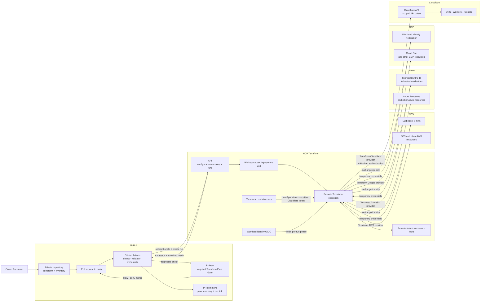
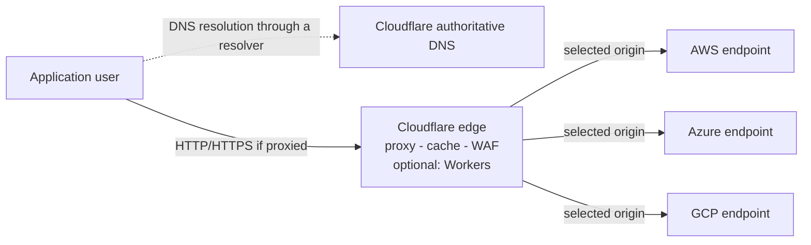
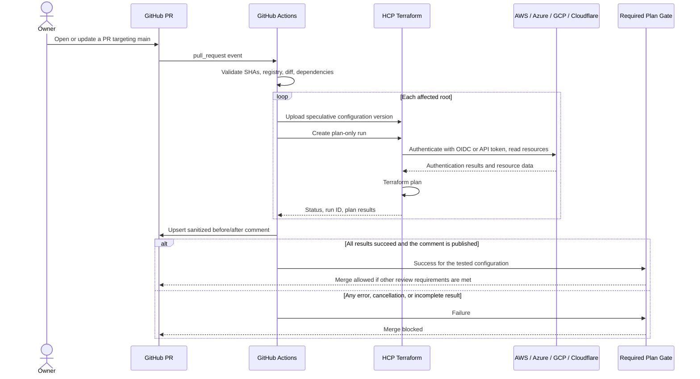
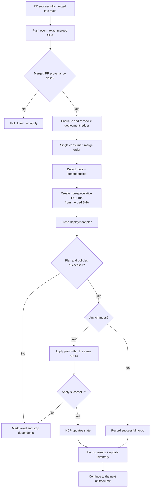

# Technical Design Document: Centralized Cloud Infrastructure

Status: Draft for discussion; not yet a deployment-ready configuration  
Date: October 27, 2026  
Proposed repository name: `centralized-cloud-infrastructure`  
Deployment branch: `main`  
Diagram format: Mermaid, so diagrams can be rendered directly in GitHub Markdown

## 1. Summary

Centralized Cloud Infrastructure is a private repository for documenting and managing cross-cloud infrastructure using Terraform. Its primary structure follows the order **cloud provider -> service -> service instance -> environment**.

GitHub serves as the source for configuration, review, and workflow orchestration. **HCP Terraform**, previously known as Terraform Cloud, runs Terraform remotely and stores state, run history, and provider authentication configuration. AWS, Azure, GCP, and **Cloudflare** are the managed providers. Cloudflare is a separate provider for services such as DNS, Workers, and rulesets/security, not an AWS service.

Infrastructure changes must go through a PR targeting `main`. The PR produces a speculative plan for review. After the PR is merged, the deployment workflow creates a new plan from the merge commit, then applies that plan within the same HCP Terraform run.

This document designs a new repository. No repository creation, cloud resource changes, or deployments are performed as part of preparing this draft.

## 2. Goals, constraints, and assumptions

### 2.1 Goals

1. Identify the providers, accounts/subscriptions/projects/zones, services, and resources owned, along with their management status.
2. Add or modify services through organized Terraform configuration.
3. Show the impact of changes before merge and block merging when validation or planning fails.
4. Run automatic applies only for changes that have been merged into `main`.
5. Reduce static credential management through identity federation and temporary credentials.
6. Isolate state and blast radius across services, environments, and cloud targets.

### 2.2 Design assumptions

- The new repository uses `main` and is separate from the website repository that provides the conversation context.
- The MVP is private and accepts changes only from the owner or trusted collaborators. Terraform code is still treated as executable code.
- A "changed folder" means a change affecting infrastructure, including modules and shared CI configuration. Documentation-only changes do not need to invoke providers.
- HCP Terraform refers to the SaaS service for remote execution and remote state, not a self-hosted Terraform Enterprise installation.
- Initial HCP setup, cloud OIDC trust, and GitHub secrets/environments are configured through controlled bootstrapping.
- AWS, Azure, and GCP use OIDC dynamic provider credentials. Cloudflare uses a scoped API token stored as sensitive in HCP; native OIDC support for Cloudflare is not assumed.
- The repository pattern supports adding more providers, but not every provider necessarily supports native dynamic credentials.
- RBAC, branch/environment protection, audit features, and run capacity must be checked against the selected GitHub and HCP Terraform plans. They are not all assumed to be available for free.

### 2.3 Outside the initial scope

- A custom web portal, application source code deployment, and application build pipelines.
- Automatic creation of all cloud accounts/subscriptions/projects.
- Automatic discovery of all resources across all clouds without scope and permission limits.
- Automatic migration of existing resources without review and import.
- Atomic transactions across workspaces or providers.
- Scheduled Terraform plans and general-purpose manual applies. Adding these features requires revising the trigger rules.
- GitHub merge queues. If used later, the `merge_group` event must be designed and tested separately.

## 3. Requirements mapping

| ID | Requirement | Design |
|---|---|---|
| R-01 | Identify the clouds owned | Provider and cloud target registries, a list of deployment units, and discovered/managed reports with the last inspection time. |
| R-02 | Provider and service structure | Roots are organized by provider, service, instance, and environment. |
| R-03 | Add services | Root/module templates, deployment unit registration, workspace/identity provisioning through onboarding, then a PR. |
| R-04 | Terraform for all clouds | Official/verified Terraform providers, controlled versions, reusable modules, and HCP remote execution. |
| R-05 | Plans per changed directory and PR comments | The change detector maps changes to roots and their dependencies, runs speculative plans, and publishes safe before/after summaries. |
| R-06 | Plans only for PRs targeting `main` | Pre-merge plans run only on PR events with base `main`; no plans on feature branch pushes, PRs to other branches, or schedules. The technical deployment exception is explained in section 8. |
| R-07 | Applies only after a PR is merged into `main` | A push to `main` must be verified as originating from a merged PR; apply uses the configuration from that merge commit. |
| R-08 | State in HashiCorp Terraform | One HCP Terraform workspace with remote state for each deployment unit. |
| R-09 | Failed plans block merging | The required aggregate check `Terraform Plan Gate` must genuinely succeed. |
| R-10 | Retry through GitHub workflows | Re-run failed jobs or re-run all jobs creates a new plan attempt and updates the same comment. |
| R-11 | Easily managed credentials | HCP variable sets, OIDC for AWS/Azure/GCP, and scoped API tokens for Cloudflare; GitHub Terraform workflows require only a restricted HCP automation credential. |

## 4. Architecture and component diagrams

### 4.1 Component responsibilities

| Component | Responsibility |
|---|---|
| GitHub repository | Terraform configuration, inventory, dependency metadata, documentation, and review history. |
| GitHub PR and ruleset | Review, required checks, merge restrictions, and dismissal of approvals when new changes arrive. |
| GitHub Actions | Change detection, validation, configuration version upload, remote run queuing, polling, PR comments, and deployment provenance. |
| HCP Terraform API | Receives configuration bundles and plan/apply requests from workflows. |
| HCP Terraform workspace | The boundary for each unit's state, execution queue, provider identity, variables, and access. |
| HCP remote execution | Runs Terraform and providers; not the GitHub runner. |
| HCP state storage | Stores state/version history and provides locking for operations that modify state. |
| Cloud identity endpoints | For AWS/Azure/GCP, verify the HCP workload identity and issue temporary credentials according to the run phase. |
| AWS | Example resources: ECS, IAM, VPC, and S3. |
| Azure | Example resources: Azure Functions, Storage Account, and networking. |
| GCP | Example resources: Cloud Run, Cloud Storage, and networking. |
| Cloudflare | The `cloudflare/cloudflare` provider for DNS, Workers, and rulesets/security according to requirements and API/provider support. |
| Inventory reporter | Combines the registry, managed resources, and limited discovery results; not a replacement for state. |

### 4.2 Component/control plane diagram



This diagram represents the management plane. It does not mean that application traffic must pass through GitHub or HCP Terraform.

### 4.3 Cloudflare's position in the data plane

Cloudflare is managed as a separate provider, but not all its services must be used. DNS can be used without proxy/CDN; proxy, cache, WAF, and Workers are enabled only according to requirements and service plans. Terraform configures Cloudflare resources; it does not become part of the user traffic path.



AWS/Azure/GCP origins are alternatives, not a requirement to use all three simultaneously. With DNS-only records, clients access the origin directly without passing through the Cloudflare proxy. Further design must determine domains/zones, DNS delegation, each record's proxy status, TLS, caching, origin protection, egress costs, and prevention of origin bypass. Workers can also serve requests without another cloud origin.

## 5. Repository structure and deployment units

```text
centralized-cloud-infrastructure
|-- .github
|   |-- workflows
|   |   |-- terraform-plan.yml
|   |   |-- terraform-apply.yml
|   |   `-- inventory.yml
|   |-- CODEOWNERS
|   `-- pull_request_template.md
|-- inventory
|   |-- providers.yaml
|   |-- targets.yaml
|   `-- deployments.yaml
|-- aws
|   `-- ecs
|   |   `-- payments
|   |       |-- dev
|   |       `-- prod
|-- azure
|   `-- azure-functions
|       `-- notification
|           `-- prod
|-- gcp
|   `-- cloud-run
|       `-- reporting
|           `-- prod
|-- cloudflare
|   |-- dns
|   |   `-- public-site
|   |       `-- prod
|   |-- workers
|   |   `-- edge-api
|   |       `-- prod
|   `-- rulesets
|       `-- public-site
|           `-- prod
|-- modules
|   |-- aws
|   |-- azure
|   |-- gcp
|   `-- cloudflare
|-- bootstrap
|-- scripts
|-- tests
`-- docs
```

Example root: `aws\ecs\payments\prod`.

Cloudflare example: `cloudflare\dns\public-site\prod`, with workspace `cci-cloudflare-dns-public-site-prod`. A Cloudflare target refers to an account and, for zone-scoped resources, a zone ID; account-scoped resources such as Workers are not forced to have a zone. Global services use region `global` or an explicitly inapplicable region attribute.

Each root contains `main.tf`, `providers.tf`, `versions.tf`, `variables.tf`, `outputs.tf`, `.terraform.lock.hcl`, and a brief README. Nonsecret variables may be stored as versioned configuration; secrets must not enter the repository.

A **deployment unit** is one Terraform root, one cloud target, one environment, and one HCP workspace/state. A resource may belong to only one state.

Example workspace: `cci-aws-ecs-payments-prod`. If a service is deployed to multiple accounts or regions, use distinguishing instance slugs and explicit mappings; do not make two roots point to the same state.

Workspace here means an **HCP Terraform workspace**, not using Terraform CLI workspaces to mix environments.

### 5.1 Deployment registry

Conceptual example, not the final schema:

```yaml
deployments:
  - id: aws-ecs-payments-prod
    root: 'aws\ecs\payments\prod'
    provider: aws
    service: ecs
    environment: prod
    target_ref: aws-production
    region: ap-southeast-1
    hcp_workspace: cci-aws-ecs-payments-prod
    lifecycle: active
    owner: platform
    depends_on:
      - aws-vpc-core-prod
    module_dependencies:
      - 'modules\aws\ecs'
```

The example uses Windows documentation path notation. The implementation consistently normalizes Git paths to the Git/API format before matching.

The schema must validate unique IDs, safe roots, unique workspaces, known targets, known dependencies, and the absence of cycles. Roots, workspaces, targets, and identity bindings must not be freely selectable through PR input.

New mappings or mapping changes require owner-approved onboarding and checks against a trusted workspace/target allowlist. A PR must not be able to redirect a root to another workspace simply by changing YAML.

### 5.2 Configuration bundles

Use a repository snapshot at the selected SHA, with an allowlist of Terraform content, local modules, and required metadata. Do not upload `.git`, secrets, state files, `.terraform`, or local plan artifacts.

Each HCP workspace has a working directory corresponding to its root. The local module structure is preserved in the bundle so that relative references remain valid. Test root/module resolution in an HCP sandbox before choosing the final bundle format.

The Terraform version is specified and compatible between validation and the remote runner. Providers are locked through `.terraform.lock.hcl`; registry modules are pinned to versions and Git modules to immutable refs.

## 6. Cloud inventory and existing resources

Terraform does not automatically know about all services previously created through the console. The catalog must distinguish:

| Inventory layer | Source | Meaning |
|---|---|---|
| Declared targets | Provider and account/subscription/project/zone registries | Clouds known to and allowed for the project. |
| Desired configuration | Terraform roots and deployment registry | Resources intended to be managed, including those not yet successfully created. |
| Managed actual | HCP state and last apply status | Resources recorded in state; may not reflect the latest live conditions. |
| Discovered actual | Cloud-native inventory APIs with read access | Resources visible within a particular scope and at a particular inspection time. |

Minimum report columns: provider, target alias/ID, service, resource ID, region, environment, owner, root/workspace if known, management status, last successful apply, last observed, and discovery errors/coverage.

Example statuses: `managed`, `discovered-unmanaged`, `declared-not-applied`, `missing-or-inaccessible`, and `unknown`. Absence from discovery results does not immediately mean a resource has been deleted.

Initial discovery uses AWS Resource Explorer or relevant per-service inventories, Azure Resource Graph, GCP Cloud Asset Inventory, and Cloudflare APIs for accounts/zones and services such as DNS, Workers, and rulesets. API coverage, regions, resource types, permissions, and pagination must be reported; do not claim the results are a complete list without evidence of coverage.

Read-only inventory may run on a schedule/manually without executing Terraform plan/apply. Its identities are separate: GitHub OIDC to read-only discovery roles in AWS/Azure/GCP, and a dedicated read-only scoped API token for Cloudflare inventory. If the Cloudflare reporter runs in GitHub, the inventory token is available only in a protected job/environment through an approved secret store; do not use Terraform's write token. This differs from HCP OIDC for Terraform runs. Access to inventory data and artifacts is restricted.

### 6.1 Onboarding existing resources

1. Register the cloud target and perform read-only discovery.
2. Determine each resource's ownership, root, and workspace.
3. Write configuration matching the existing conditions and declare Terraform `import` blocks.
4. Run a PR speculative plan to review imports and potential changes.
5. Merge after inspection; the deployment run performs the imports and changes that were actually approved.
6. Verify state and inventory; do not import resources already managed by another state.

Moving existing local state to HCP is a controlled bootstrap migration with backups and a change freeze, not copying `.tfstate` into the repository.

## 7. PR plan flow

### 7.1 Triggers and relevant changes

The workflow uses `pull_request` with base `main`, including the `opened`, `synchronize`, `reopened`, `ready_for_review` activities, and relevant base changes. The base check is repeated at runtime.

Do not use a top-level path filter that could prevent the required check from ever appearing. The workflow still runs for documentation PRs, then the gate reports `success` with the reason "no infrastructure changes".

The change detector:

1. Determines PR changes using the merge base and head, not just the latest commit.
2. Retrieves the complete file list, including pagination, renames, and deletions.
3. Maps direct roots and shared modules transitively from the base and head registries.
4. Includes consumers affected by dependency output changes, shared bootstrap/configuration, provider locks/configuration, and orchestration workflows/scripts.
5. Runs all relevant roots if dependencies cannot be safely narrowed down. An invalid registry or unmapped infrastructure files cause failure.
6. Records the PR head SHA, base SHA, tested merge SHA, bundle digest, workspace, GitHub attempt, and HCP run ID.

Plans test the combined PR configuration with the recorded base, not an arbitrary checkout of a moving branch. All comments state the tested SHA. If the head/base has changed, old results are marked stale and must not be considered valid for the latest merge.

### 7.2 Speculative plan execution

For each affected root:

1. Validate formatting, schema, and configuration; failures immediately block the gate.
2. Create an HCP configuration version with `auto-queue-runs=false` and `speculative=true`.
3. Upload the immutable bundle; wait until the configuration version is ready.
4. Create a run with `plan-only=true`, linked to the correct configuration version and workspace.
5. Poll until a terminal result; a temporary `planned` status is insufficient if other checks are still running.
6. Retrieve the plan results, sanitize them, and create a report.

`speculative=true` ensures that the PR configuration version cannot be confirmed for apply. Workspace auto-apply is disabled. There is no separate VCS auto-run in HCP that could duplicate or bypass the GitHub workflow.

No-change is success. Provider errors, validation failures, policy failures, timeouts, cancellations, or missing results are not success. If hard policies are added later, the gate must wait for their evaluation. Policy overrides are not available to the regular pipeline.

### 7.3 PR sequence diagram



### 7.4 PR comment format

One managed bot comment per PR with a stable marker, for example `<!-- cci:terraform-plan -->`. Update only the bot-managed section and preserve human-written text.

Minimum content:

- Head/base/tested SHAs, time, and workflow attempt.
- Root, workspace, and HCP run link.
- Summary of `add`, `change`, `destroy`, `replace`, and `import`.
- Before/after values of safe attributes; replacement is explicitly displayed as destroy/create.
- Unknown values are written as `known after apply`; sensitive values as `[REDACTED]`.
- Failed root status, safe error summary, and retry steps.

Example display format, not actual plan results:

| Root | Result | Impact | Example before -> after |
|---|---|---|---|
| `aws\ecs\payments\prod` | Success | 0 add, 1 change, 0 destroy | `desired_count: 2 -> 3` |
| `azure\azure-functions\notification\prod` | No changes | No changes | - |
| `cloudflare\dns\public-site\prod` | Failed | Cannot be calculated | Provider authorization error |

The last summary fails, so the overall gate remains failed.

Do not paste raw state, binary plans, full JSON plans, or raw logs into public comments/artifacts. Terraform sensitive markers help but do not guarantee that all secrets are marked. Use an allowlist of safe attributes, size limits, and links to HCP for permission-restricted details. If a required comment cannot be published, the gate fails rather than silently succeeding.

### 7.5 Required check and merge protection

- The required check has a fixed, unique name: `Terraform Plan Gate`.
- The aggregate job always runs, for example with `always()`, and checks all expected roots against the actual results.
- The matrix uses `fail-fast: false` so that one root's failure does not hide other roots' results.
- Skipped/cancelled jobs or missing artifacts do not count as successful plans; docs-only is an explicit success branch.
- Require PRs, an up-to-date branch, reviews appropriate to the team's capabilities, dismissal of stale approvals, and conversation resolution.
- Block direct pushes, force pushes, and bypasses, including administrator bypasses, as far as account features allow.
- Protect workflows, scripts, inventory mappings, and bootstrap with CODEOWNERS.
- Restrict the check source to the expected GitHub Actions integration where available; workflows remain part of the trust boundary.

## 8. Post-merge apply flow

### 8.1 Meaning of the "plans only on PRs" rule

**Pre-merge/speculative plans are triggered only by PRs targeting `main`.** However, Terraform still needs to generate a plan for deployment after merge.

The draft's interpretation: there are no standalone plans on other events, but **an internal plan within a deployment run after a merged PR is allowed**, and that plan is then applied in the same run.

The literal interpretation "no plans whatsoever after merge" conflicts with the choice of speculative plans: speculative plans cannot be applied. The saved-plan promotion alternative requires a different design, guarantees that SHA/state still match, and stale-plan handling. The draft chooses a fresh deployment plan for safety and simplicity.

### 8.2 Triggers and provenance

The workflow is triggered by `push` to `main`, not all pushes. Before accessing apply credentials:

1. Validate that the commit is genuinely the result of a PR merged into base `main`, using PR associations and merge metadata through the GitHub API.
2. Verify that the PR passed required checks and merge policies; block commits without matching provenance.
3. Check out the exact `github.sha` from the push, not implicitly the latest `main`.
4. Calculate affected roots from the parent commit before merge to the merge commit, including dependency expansion.

The MVP uses Squash and Merge so that each merged PR has one clearly identifiable deployment commit. There is no `workflow_dispatch`, schedule, or routine UI apply; apply permission belongs only to the deployment automation principal. Emergency break-glass is outside the normal flow, must be audited, and cannot be claimed to meet absolute restrictions on platform-owner administrators.

### 8.3 Deployment execution

1. Serialize the repository apply pipeline so that successive merges do not overtake one another.
2. GitHub Actions `concurrency` alone is not a durable FIFO based on merge order. The default `queue: single` can replace a pending run; `queue: max` holds up to 100 pending runs, but their order is based on when they started waiting, not commit order. Use a single consumer and a persistent ledger as the source of ordering; `queue: max` may serve as a runner queuing mechanism, not a replacement for reconciliation.
3. Store a nonsecret ledger containing the PR, source SHA, target roots, bundle digest, HCP run IDs, and per-unit status. The ledger is stored in controlled storage outside Git history, with conditional writes/locking; it is not a replacement for Terraform state.
4. The dispatcher verifies commit ancestry order, adds unrecorded merged commits if events were delayed/lost, and then processes them in order. Without successful enqueue/ledger recording, the workflow fails and deployment is not considered complete.
5. For each root ready according to the DAG, create a configuration version with `speculative=false`, `auto-queue-runs=false`.
6. Create a non-speculative run with `auto-apply=false`; wait for the plan and all checks to succeed.
7. Invoke apply on **that run ID**, rather than creating an apply from the PR plan or another configuration.
8. Wait for `applied` status, or a valid terminal no-change result, then record the outcome and update the summary/inventory.

HCP locking protects state per workspace; the deployment queue protects cross-workspace ordering. Do not cancel an in-progress apply just because a new commit arrives.

The final storage/dispatcher choice is an implementation decision in the foundation phase. Do not replace the durable queue requirement with an assumption that GitHub concurrency is FIFO.

### 8.4 Deployment flow diagram



### 8.5 Dependencies and partial failures

Each service is independent by default. Networks, IAM, DNS, or shared resources use their own roots and an explicit dependency DAG.

- Applies follow topological order; independent roots may run in parallel if deployment ordering is not compromised.
- Changed producer outputs add consumers to the affected set even if consumer files have not changed.
- A consumer's PR speculative plan reads the producer's current state, not automatically the producer's future outputs.
- If future outputs are needed, split the work into staged PRs or use more appropriate coordination within a single root. Comments must not claim that a consumer has tested outputs that do not yet exist.
- Use nonsecret outputs with minimum access; avoid granting access to entire states across workspaces.
- After one root fails, dependent roots do not proceed. By default, the queue stops until the failure is reconciled, so that later commits do not skip over a partially deployed condition.
- There is no atomic multi-cloud rollback. Recovery uses a verified re-plan/retry or a reviewed fix/revert PR.

## 9. Credentials, identities, and safeguards

### 9.1 Two authentication boundaries

**GitHub Actions -> HCP Terraform**

- Separate HCP automation tokens for plan and deployment; prefer team/service automation identities appropriate to the service plan.
- The plan identity may only queue/read plans in the required workspaces; it must not apply or change variables, state, trust, or workspace settings.
- The apply identity is placed in a protected GitHub Environment that accepts only the `main` branch, with minimum workspace scope.
- GitHub stores HCP tokens as secrets; tokens must not enter YAML, logs, or comments.
- Do not assume GitHub OIDC automatically replaces the HCP API token; this design still requires a supported HCP API credential, with controlled rotation and expiration.
- Minimum built-in GitHub token permissions: read source; the comment job receives the necessary PR comment permissions; do not give cloud admin credentials to the GitHub runner.

**HCP Terraform -> AWS/Azure/GCP**

- HCP issues an OIDC workload token for each run phase.
- Cloud trust is restricted by issuer, audience, organization, project, workspace, and `run_phase`.
- The plan phase uses the minimum read identity required by providers/data sources; apply uses the minimum write identity for the relevant resources.
- Temporary cloud credentials are created during the run and are not stored in the repository or GitHub secrets.

**HCP Terraform -> Cloudflare**

- Use the `cloudflare/cloudflare` provider and an API token with minimum permissions for the relevant account/zone resources; do not use the Global API Key.
- Store the token as the sensitive environment variable `CLOUDFLARE_API_TOKEN` in the HCP workspace or a variable set with restricted attachments. Do not store it in GitHub Terraform workflows, `.tfvars` files, state outputs, or comments.
- Prefer account-owned API tokens if the required endpoints are compatible; otherwise, use a user API token with documented ownership and rotation.
- Native HCP OIDC support for Cloudflare is not assumed. API tokens must have clear TTL/rotation/revocation and resource scope.
- A workspace token does not automatically have different permissions for the plan and apply phases. The write token needed by apply is also available during plan when using the same variable; HCP plan-only prevents that run from being applied, not token abuse by malicious code. The MVP still requires trusted collaborators and review before remote execution of new code; per-phase credential separation requires an additional controlled injection/broker mechanism that must be designed before accepting untrusted contributions.

### 9.2 Provider mapping

| Provider | Trust and identity | Conceptual HCP configuration |
|---|---|---|
| AWS | IAM OIDC provider and separate plan/apply roles; STS temporary credentials | `TFC_AWS_PROVIDER_AUTH`, `TFC_AWS_PLAN_ROLE_ARN`, `TFC_AWS_APPLY_ROLE_ARN`. |
| Azure | Entra applications/service principals with minimum RBAC and federated identity credentials per workspace/phase | `TFC_AZURE_PROVIDER_AUTH`, `TFC_AZURE_PLAN_CLIENT_ID`, `TFC_AZURE_APPLY_CLIENT_ID`; tenant/subscription configured according to the provider. |
| GCP | Workload Identity Pool/Provider and separate plan/apply service accounts, with claim conditions and minimum IAM | `TFC_GCP_PROVIDER_AUTH`, `TFC_GCP_WORKLOAD_PROVIDER_NAME`, `TFC_GCP_PLAN_SERVICE_ACCOUNT_EMAIL`, `TFC_GCP_APPLY_SERVICE_ACCOUNT_EMAIL`. |
| Cloudflare | Scoped API token for the required accounts/zones and operations, separate from AWS credentials | `CLOUDFLARE_API_TOKEN` as a sensitive environment variable; nonsecret account/zone IDs; native HCP OIDC federation is not assumed. |

Role/client/account identifiers are generally not secrets, but their visibility is still restricted. Azure federated credentials must match the different plan/apply subjects; the issuer for Terraform runs is HCP, not GitHub.

HCP variable sets are grouped by provider/target/environment and attached only to authorized workspaces. Variable sets reduce duplication, not justify global privileges.

Providers without federation use centralized secrets in HCP or an approved secret manager, with sensitive flags, minimum scope, an owner, a rotation schedule, and revocation procedures.

### 9.3 PR trust boundary

Terraform plans can execute providers, modules, and data source programs. Plan-only does not mean safe against malicious code; state and credential access remain sensitive, especially Cloudflare tokens with write permissions.

- Do not run fork/untrusted code with HCP/cloud credentials.
- Do not use `pull_request_target` to check out and execute PR source with secrets.
- For the MVP, fork PRs do not receive remote credentialed plans and the gate remains failed until the changes are transferred and reviewed through a trusted flow.
- Protect workflow and identity mapping changes; review new modules/providers.
- Pin GitHub Actions to commit SHAs, restrict `GITHUB_TOKEN`, and avoid interpolating PR titles/branches/inputs into shell commands.
- The comment publisher processes only sanitized data; it does not execute artifacts/scripts from PR results.
- Use a private repository and restrict access to state, plan details, inventory, artifacts, and HCP runs.

## 10. State, retries, and operations

### 10.1 State

- One workspace/state per deployment unit with separate permissions.
- No `.tfstate`, `.tfplan`, credentials, or `.terraform` in Git.
- State history and locking are managed by HCP; retention, backup/recovery, and access policies follow requirements and the service plan.
- The sensitive flag does not remove secrets from state. Treat all state as sensitive data.
- No automatic force-unlock; operators ensure that no remote operations are active before recovery.

### 10.2 Retrying plans from GitHub

- Support **Re-run failed jobs** and **Re-run all jobs** without creating a new commit.
- Each rerun job creates a new attempt and a new HCP plan-only run, rather than treating a failed result as success.
- Minimum correlation identity: PR, source/tested SHA, root, GitHub run ID, and `run_attempt`.
- The aggregate gate uses root results from the relevant attempt; successful roots that are not rerun may be reused only if the SHA and dependency set are the same.
- GitHub reruns use the original event's ref/SHA. If the PR has changed or closed, an old attempt must not publish a "current" report or perform a deployment.
- Retry APIs only for transient errors with bounded backoff; report authorization/configuration failures immediately.
- Cancelling a GitHub job does not automatically cancel an HCP run; the pipeline reconciles/cancels speculative runs where appropriate, without cancelling active applies.

### 10.3 Retrying applies

Retries must not blindly duplicate apply requests. Find the run in the ledger:

- Run still active: continue monitoring.
- Run already applied: record success; do not apply again.
- Run failed/partial: read the latest state and create a controlled recovery run for the same merged configuration.
- Run no longer relevant because of another recovery: explicitly mark it superseded.

Recovery is only for changes whose provenance still originates from a merged PR, not an arbitrary branch/configuration.

### 10.4 Deletion and structural changes

Deleting a folder does not automatically destroy cloud resources. The pipeline rejects missing roots if their workspaces still contain resources.

Decommissioning is staged: change the configuration to destroy the intended resources, review the destructive plan, merge/apply, verify that state is empty, then remove the root and archive the workspace. Critical resources use deletion protection/`prevent_destroy` where appropriate; guard changes still require review.

Renaming a root does not mean creating a new workspace. Preserve the workspace/state binding through an approved registry migration. Resource address changes use `moved` blocks where appropriate to avoid unwanted recreation.

### 10.5 Observability

Each deployment has a GitHub summary containing the PR, SHA, root, HCP run ID, status, and time. Plan/apply/inventory/queue failures are sent to the agreed notification channels.

Automatic drift detection using Terraform plans is not enabled in the MVP because of the trigger rules. Inventory may indicate mismatches but is not a replacement for Terraform drift analysis. To introduce scheduled drift plans, R-06 must be explicitly expanded.

## 11. Bootstrapping and adding services

### 11.1 One-time initial bootstrap

1. Create a new private repository with branch `main`; enable rulesets, merge mode, and CODEOWNERS according to the account plan.
2. Create the HCP organization/project, initial bootstrap workspace, automation teams/permissions, and variable sets.
3. Using audited temporary admin access, create AWS/Azure/GCP OIDC trust and plan/apply identities; prepare scoped Cloudflare API tokens for approved accounts/zones.
4. Create initial workspaces and working directory mappings; disable VCS auto-run and workspace auto-apply.
5. Store HCP plan/deployment tokens in the appropriate GitHub locations, prepare the queue/ledger, then test in a sandbox.
6. Revoke temporary admin credentials; store bootstrap configuration as IaC with separate state and privileges.

Bootstrapping resolves the initial dependency: workflows cannot create the trust/credentials needed to authenticate themselves for the first time without initial access.

### 11.2 Adding a service

1. Choose an existing provider/target or onboard a new target.
2. Copy the root template and use the appropriate modules.
3. Add the deployment registry entry, owner, dependencies, and nonsecret inventory information.
4. Provision the HCP workspace and identity binding through a separate bootstrap control plane; the service PR must not obtain admin rights to do this itself.
5. Open a PR targeting `main`, review the plan comment, and merge only when the gate succeeds.
6. Monitor deployment and verify resources in the inventory.

## 12. Testing and acceptance criteria

### 12.1 Testing strategy

- Unit tests for the schema, change detector, dependency closure, plan sanitizer, aggregate gate, provenance checks, and retry/ledger state machine.
- For tooling source code, a minimum coverage target of 90% per source file for statements, branches, functions, and lines; not imposed as an irrelevant metric for declarative Terraform files.
- Terraform formatting/validation, appropriate module tests, and lint/security checks, without treating them as replacements for remote plans.
- Integration tests using an HCP sandbox and nonproduction cloud targets with small resources, budget limits, and controlled cleanup.
- Test the actual GitHub UI/API for required checks, comments, reruns, environment protection, and merged-PR-only applies.
- Because the project's output is IaC/workflows, not a web application, end-to-end validation executes the exact configuration bundle and source SHA published by the pipeline; it does not create fictitious application browser tests.

### 12.2 Acceptance scenarios

| ID | Scenario | Required outcome |
|---|---|---|
| A-01 | The registry includes AWS, Azure, GCP, and Cloudflare | Reports distinguish declared, managed, discovered-unmanaged, and unknown, including Cloudflare account/zone scope and inspection time. |
| A-02 | A PR targeting `main` changes one ECS root | That root is planned; independent roots are not planned without a dependency reason. |
| A-03 | A PR changes a shared module | All transitive consumers enter the affected set. |
| A-04 | A PR targets a branch other than `main`, or a feature branch is pushed | No remote Terraform plan/apply. |
| A-05 | A PR plan succeeds with safe changes | The comment shows before/after, actions, tested SHA, and an HCP link; the gate succeeds. |
| A-06 | One root's plan fails | The comment records the failure; the required gate fails and GitHub rejects the merge. |
| A-07 | A documentation-only PR | No provider run; the required gate explicitly succeeds. |
| A-08 | Retry a failed plan job | A new HCP plan attempt runs and the comment is updated without duplication or claiming an old SHA is the latest. |
| A-09 | A new commit arrives while an old plan is running | The old plan cannot pass the new commit or overwrite the current report with stale results. |
| A-10 | A PR closes without merging | No apply. |
| A-11 | A direct push or event without merged-PR provenance | Blocked by the ruleset or rejected by the deployment workflow; no apply. |
| A-12 | A valid PR is merged into `main` | The fresh deployment plan comes from the exact merged SHA; apply uses the same run ID. |
| A-13 | The deployment plan or policy fails | No apply; the queue/dependents stop and the failure is visible. |
| A-14 | Two/three PRs merge close together | No deployments are lost/reordered; queue reconciliation and state locking are proven to work. |
| A-15 | Retry apply after a successful/partial result | Does not duplicate a successful apply; partial failure produces a recovery that reads the latest state. |
| A-16 | A fork PR or unauthorized binding change | Receives no credentials and cannot access another workspace. |
| A-17 | A plan contains secrets and unknown values | Secrets do not appear in PRs/public logs; unknowns are not presented as definite values. |
| A-18 | An active folder is deleted/renamed | No orphan state or accidental recreation; decommission/migration policy is enforced. |
| A-19 | The HCP plan identity attempts to apply, or the cloud plan role attempts to write | HCP rejects apply; AWS/Azure/GCP reject writes according to plan-phase roles. Cloudflare API tokens are not claimed to receive automatic phase isolation. |
| A-20 | Existing resources are imported | No unintended recreation; single-state ownership is verified. |
| A-21 | A comment fails, a root result is missing, or a job is cancelled | The gate fails, rather than returning skipped/neutral that is considered passing. |
| A-22 | Discovery fails or scope is incomplete | Reports show unknown/error, not that resources do not exist. |
| A-23 | A Cloudflare root runs plan/apply and its token accesses a zone outside its scope | Valid runs use only the approved scope; out-of-scope access is denied; the token is not visible in logs/comments. |
| A-24 | Cloudflare DNS-only versus proxied records | Configuration and operational diagrams do not claim that all traffic passes through the proxy; DNS/proxy/TLS match the reviewed choices. |

## 13. Implementation phases

1. **Foundation and bootstrap:** platform/plan decisions, new repository, inventory schema, HCP organization/project, sandbox, identities, and branch protection.
2. **Single-root PR plan:** immutable bundle, HCP speculative run, sanitizer/comment, stable gate, and retries; prove that failures genuinely block merging.
3. **Post-merge deployment:** provenance, durable queue/ledger, exact-SHA non-speculative run, apply, and recovery.
4. **Multi-provider and dependencies:** AWS/Azure/GCP/Cloudflare roots, scoped Cloudflare tokens, consumer impact analysis, and cross-root acceptance tests.
5. **Existing infrastructure and inventory:** measured discovery, staged imports, ownership, and operational reports.

Each phase is split into coherent commits with reasons for the changes. No production deployment occurs before critical acceptance scenarios and security boundaries are proven in a sandbox.

## 14. Trade-offs and open decisions

| Topic | Draft choice | Consequences / further decisions |
|---|---|---|
| Execution | HCP remote execution, GitHub API-driven orchestration | Clear trigger/retry control, but requires polling, reporting, and error-handling tooling. |
| PR plan vs deployment | Speculative PR plan + fresh post-merge plan | Safe against stale state, but post-merge results may differ; a pre-merge plan does not guarantee a successful apply. |
| Isolation | Many small workspaces per deployment unit | Small blast radius; more onboarding, permissions, and dependencies. |
| Discovery | Registry + cloud-native inventory | Existing resources become visible gradually; completeness depends on permissions and API coverage. |
| Auth | HCP OIDC for AWS/Azure/GCP; scoped API tokens for Cloudflare; separate API tokens for HCP | Reduces static cloud keys, but HCP/Cloudflare tokens still need rotation. Cloudflare does not automatically receive separate plan/apply permissions. |
| Queue/ledger | Durable single-consumer, non-Git storage | Choose storage and dispatcher hosting with conditional writes, audit, and recovery before building the apply pipeline. |
| Service plans | Not yet selected | Confirm RBAC, environment/branch protection, concurrency, retention, and costs. |
| Cloud targets | Not yet registered | Complete accounts/subscriptions/projects/zones, regions or global scope, owners, and environment classifications. |
| Approval | Mandatory plan gate; human review appropriate to the team | A sole owner cannot satisfy a second-reviewer policy without a collaborator; do not create an unworkable policy. |
| Cloudflare | Separate provider; services selected according to requirements | Determine accounts/zones, DNS, Workers, rulesets, proxy/CDN/WAF if needed, plans, and origins; do not assume all features must be enabled. |
| Scheduled drift | Disabled | Requires changing the requirements if scheduled plans are desired. |
| Recovery objective | Not yet determined | Define recovery time, downtime tolerance, state/artifact retention, and budget before production. |

## 15. References

The design refers to the following official documentation, checked when preparing the draft. Feature support and plan limits may change.

1. [HCP Terraform: API-driven run workflow](https://developer.hashicorp.com/terraform/cloud-docs/workspaces/run/api)
2. [HCP Terraform: Configuration versions API](https://developer.hashicorp.com/terraform/cloud-docs/api-docs/configuration-versions)
3. [HCP Terraform: Runs API](https://developer.hashicorp.com/terraform/cloud-docs/api-docs/run)
4. [HCP Terraform: Dynamic provider credentials](https://developer.hashicorp.com/terraform/cloud-docs/dynamic-provider-credentials)
5. [Dynamic credentials: AWS](https://developer.hashicorp.com/terraform/cloud-docs/dynamic-provider-credentials/aws-configuration)
6. [Dynamic credentials: Azure](https://developer.hashicorp.com/terraform/cloud-docs/dynamic-provider-credentials/azure-configuration)
7. [Dynamic credentials: GCP](https://developer.hashicorp.com/terraform/cloud-docs/dynamic-provider-credentials/gcp-configuration)
8. [HCP Terraform: Workspace permissions](https://developer.hashicorp.com/terraform/cloud-docs/users-teams-organizations/permissions/workspace)
9. [GitHub Actions: Events that trigger workflows](https://docs.github.com/en/actions/reference/workflows-and-actions/events-that-trigger-workflows)
10. [GitHub Actions: Re-running workflows and jobs](https://docs.github.com/en/actions/how-tos/manage-workflow-runs/re-run-workflows-and-jobs)
11. [GitHub: Protected branches](https://docs.github.com/en/repositories/configuring-branches-and-merges-in-your-repository/managing-protected-branches/about-protected-branches)
12. [GitHub Actions: Control workflow concurrency](https://docs.github.com/en/actions/how-tos/write-workflows/choose-when-workflows-run/control-workflow-concurrency)
13. [Cloudflare Terraform provider](https://developers.cloudflare.com/terraform/)
14. [Cloudflare: Create API token](https://developers.cloudflare.com/fundamentals/api/get-started/create-token/)
