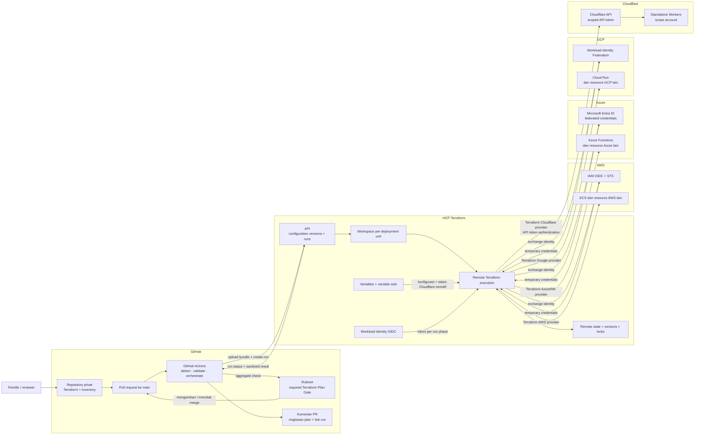
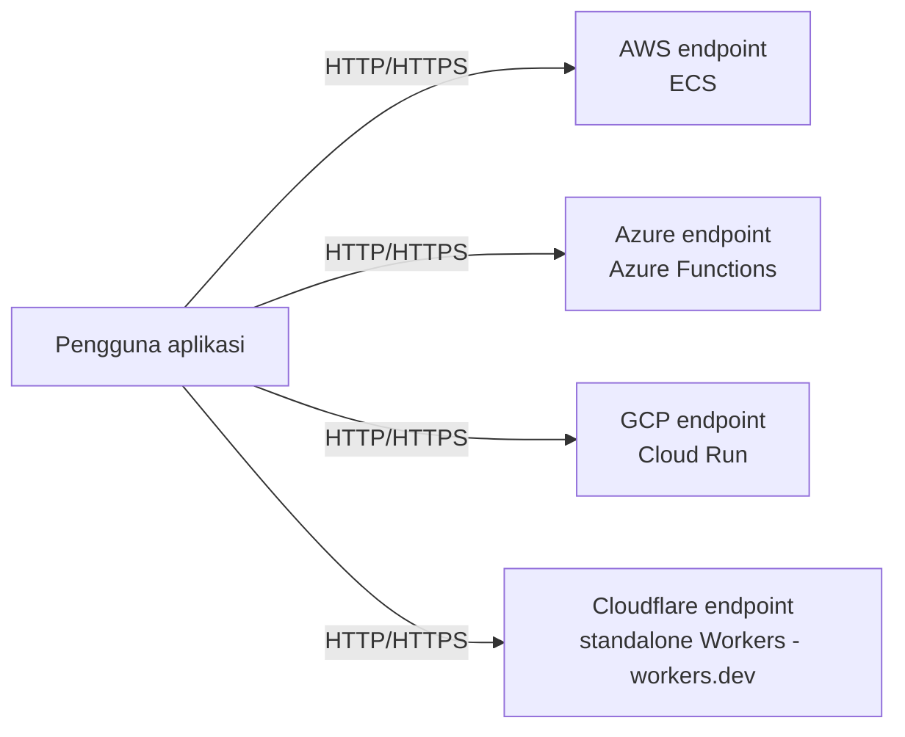
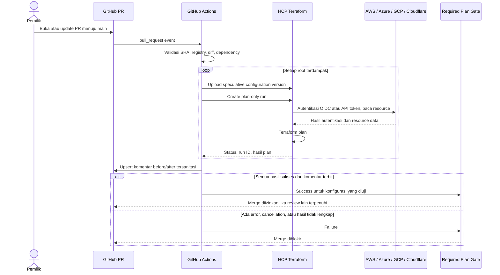
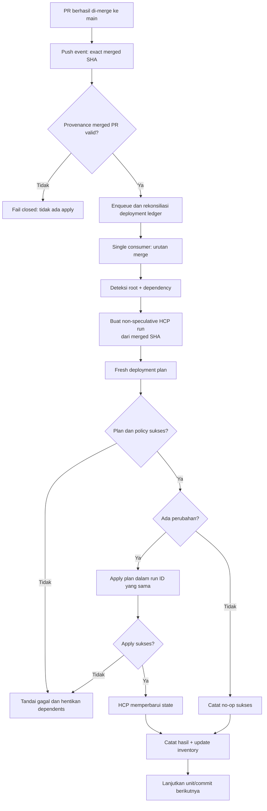

# Technical Design Document: Centralized Cloud Infrastructure

Status: Draft untuk pembahasan; belum merupakan konfigurasi siap deploy  
Tanggal: 27 Oktober 2026  
Nama repository yang diusulkan: `centralized-cloud-infrastructure`  
Branch deployment: `main`  
Format diagram: Mermaid, agar dapat dirender langsung dalam Markdown GitHub

## 1. Ringkasan

Centralized Cloud Infrastructure adalah repository privat untuk mendokumentasikan dan mengelola infrastruktur lintas cloud menggunakan Terraform. Struktur utamanya mengikuti urutan **cloud provider -> layanan -> instance layanan -> environment**.

GitHub menjadi sumber konfigurasi, review, dan orkestrasi workflow. **HCP Terraform**, sebelumnya dikenal sebagai Terraform Cloud, menjalankan Terraform secara remote serta menyimpan state, riwayat run, dan konfigurasi autentikasi provider. AWS, Azure, GCP, dan **Cloudflare** adalah provider yang dikelola secara independen. Pada iteration-1, workload Cloudflare berfokus pada standalone Workers, bukan layanan milik AWS atau lapisan wajib di depan AWS/Azure/GCP.

Perubahan infrastruktur harus melewati PR menuju `main`. PR menghasilkan speculative plan untuk direview. Setelah PR di-merge, workflow deployment membuat plan baru dari commit hasil merge, kemudian meng-apply plan tersebut dalam HCP Terraform run yang sama.

Dokumen ini adalah rancangan repository baru. Tidak ada pembuatan repository, perubahan resource cloud, atau deployment yang dilakukan sebagai bagian dari penyusunan draft.

## 2. Tujuan, batasan, dan asumsi

### 2.1 Tujuan

1. Mengetahui provider, account/subscription/project, layanan, dan resource yang dimiliki beserta status pengelolaannya.
2. Menambahkan atau mengubah layanan melalui konfigurasi Terraform yang terorganisasi.
3. Memperlihatkan dampak perubahan sebelum merge dan memblokir merge ketika validasi atau plan gagal.
4. Menjalankan apply otomatis hanya untuk perubahan yang sudah di-merge ke `main`.
5. Mengurangi pengelolaan kredensial statis melalui federasi identitas dan temporary credentials.
6. Mengisolasi state dan blast radius antar-service, environment, dan target cloud.

### 2.2 Asumsi rancangan

- Repository baru menggunakan `main`, terpisah dari repository website yang menjadi konteks percakapan.
- MVP bersifat privat dan hanya menerima perubahan dari pemilik atau collaborator tepercaya. Kode Terraform tetap dianggap executable code.
- Kata "folder berubah" berarti perubahan yang memengaruhi infrastruktur, termasuk module dan konfigurasi CI bersama. Perubahan dokumentasi murni tidak perlu memanggil provider.
- HCP Terraform yang dimaksud adalah layanan SaaS untuk remote execution dan remote state; bukan instalasi Terraform Enterprise mandiri.
- Initial setup HCP, trust OIDC cloud, dan GitHub secrets/environment dilakukan melalui bootstrap terkontrol.
- AWS, Azure, dan GCP memakai dynamic provider credentials OIDC. Cloudflare memakai scoped API token yang disimpan secara sensitif di HCP; dukungan OIDC native untuk Cloudflare tidak diasumsikan.
- Cloudflare Workers menggunakan scope account dan endpoint standalone `workers.dev`; zone ID dan zone permissions tidak diperlukan.
- Penambahan provider berikutnya didukung pola repository, tetapi tidak semua provider pasti mendukung dynamic credentials native.
- Fitur RBAC, proteksi branch/environment, audit, dan kapasitas run harus diperiksa terhadap paket GitHub dan HCP Terraform yang dipilih. Tidak diasumsikan seluruhnya tersedia gratis.

### 2.3 Di luar scope awal

- Portal web khusus, deployment source code aplikasi, dan pipeline build aplikasi.
- Pembuatan otomatis seluruh cloud account/subscription/project.
- Penemuan otomatis seluruh resource di semua cloud tanpa batas cakupan dan izin.
- Migrasi otomatis resource existing tanpa peninjauan dan import.
- Transaksi atomik lintas-workspace atau lintas-provider.
- Cloudflare authoritative DNS, WAF, rulesets/security, serta integrasi proxy/CDN di depan workload cloud lain tidak termasuk scope iteration-1.
- Scheduled Terraform plan dan apply manual umum. Penambahan fitur tersebut perlu revisi aturan trigger.
- Merge queue GitHub. Jika nanti digunakan, event `merge_group` harus dirancang dan diuji tersendiri.

## 3. Pemetaan requirement

| ID | Kebutuhan | Rancangan |
|---|---|---|
| R-01 | Mengetahui cloud yang dimiliki | Registry provider dan target cloud, daftar deployment unit, serta laporan discovered/managed dengan waktu pemeriksaan terakhir. |
| R-02 | Struktur provider dan layanan | Root disusun sebagai provider, layanan, instance, dan environment. |
| R-03 | Menambah layanan | Template root/module, registrasi deployment unit, provisioning workspace/identity melalui onboarding, lalu PR. |
| R-04 | Terraform untuk semua cloud | Terraform provider resmi/terverifikasi untuk AWS/Azure/GCP dan standalone Cloudflare Workers, versi terkontrol, module reusable, dan HCP remote execution. |
| R-05 | Plan per direktori yang berubah dan komentar PR | Change detector memetakan perubahan ke root beserta dependency, menjalankan speculative plan, lalu memublikasikan ringkasan before/after yang aman. |
| R-06 | Plan hanya untuk PR menuju `main` | Pre-merge plan hanya pada event PR dengan base `main`; tidak ada plan pada push feature branch, PR ke branch lain, atau jadwal. Pengecualian teknis deployment dijelaskan pada bagian 8. |
| R-07 | Apply hanya setelah PR di-merge ke `main` | Push `main` harus diverifikasi berasal dari merged PR; apply mengambil konfigurasi commit hasil merge tersebut. |
| R-08 | State di Terraform HashiCorp | Satu HCP Terraform workspace dengan remote state untuk setiap deployment unit. |
| R-09 | Plan gagal memblokir merge | Required aggregate check `Terraform Plan Gate` wajib benar-benar success. |
| R-10 | Retry melalui workflow GitHub | Re-run failed jobs atau re-run all jobs membuat percobaan plan baru dan memperbarui komentar yang sama. |
| R-11 | Kredensial mudah dikelola | HCP variable sets, OIDC untuk AWS/Azure/GCP, dan scoped API token untuk Cloudflare; workflow Terraform GitHub hanya memerlukan credential otomasi HCP yang dibatasi. |

## 4. Arsitektur dan diagram komponen

### 4.1 Tanggung jawab komponen

| Komponen | Tanggung jawab |
|---|---|
| GitHub repository | Terraform configuration, inventory, dependency metadata, dokumentasi, dan riwayat review. |
| GitHub PR dan ruleset | Review, required check, pembatasan merge, dan dismissal approval ketika perubahan baru masuk. |
| GitHub Actions | Deteksi perubahan, validasi, upload configuration version, antre remote run, polling, komentar PR, dan deployment provenance. |
| HCP Terraform API | Menerima configuration bundle dan request plan/apply dari workflow. |
| HCP Terraform workspace | Batas state, execution queue, identity provider, variable, dan akses setiap unit. |
| HCP remote execution | Menjalankan Terraform dan provider; bukan GitHub runner. |
| HCP state storage | Menyimpan state/version history dan menyediakan locking untuk operasi yang mengubah state. |
| Cloud identity endpoints | Untuk AWS/Azure/GCP, memverifikasi HCP workload identity dan memberikan temporary credentials sesuai fase run. |
| AWS | Contoh resource: ECS, IAM, VPC, dan S3. |
| Azure | Contoh resource: Azure Functions, Storage Account, dan networking. |
| GCP | Contoh resource: Cloud Run, Cloud Storage, dan networking. |
| Cloudflare | Provider `cloudflare/cloudflare` untuk standalone Workers pada scope account, independen dari workload AWS/Azure/GCP. |
| Inventory reporter | Menggabungkan registry, resource terkelola, dan hasil discovery terbatas; bukan pengganti state. |

### 4.2 Diagram komponen/control plane



Diagram ini menggambarkan management plane. Tidak berarti trafik aplikasi harus melewati GitHub atau HCP Terraform.

### 4.3 Endpoint workload independen pada data plane

AWS, Azure, GCP, dan Cloudflare menyediakan endpoint workload masing-masing. Standalone Workers melayani request melalui endpoint `workers.dev` tanpa memerlukan origin di cloud lain. Terraform mengonfigurasi resource setiap provider, bukan menjadi jalur trafik pengguna.



Keempat endpoint adalah alternatif independen, bukan rantai trafik atau kewajiban menggunakan semuanya sekaligus. Cloudflare tidak diwajibkan menjadi proxy/CDN bagi AWS/Azure/GCP. Cloudflare authoritative DNS, WAF, dan rulesets/security tidak dikonfigurasi pada iteration-1; standalone Workers tidak memerlukan zone ID atau zone permissions.

## 5. Struktur repository dan deployment unit

```text
centralized-cloud-infrastructure
|-- .github
|   |-- workflows
|   |   |-- terraform-plan.yml
|   |   |-- terraform-apply.yml
|   |   `-- inventory.yml
|   |-- CODEOWNERS
|   `-- pull_request_template.md
|-- inventory
|   |-- providers.yaml
|   |-- targets.yaml
|   `-- deployments.yaml
|-- aws
|   `-- ecs
|   |   `-- payments
|   |       |-- dev
|   |       `-- prod
|-- azure
|   `-- azure-functions
|       `-- notification
|           `-- prod
|-- gcp
|   `-- cloud-run
|       `-- reporting
|           `-- prod
|-- cloudflare
|   `-- workers
|       `-- standalone-api
|           `-- prod
|-- modules
|   |-- aws
|   |-- azure
|   |-- gcp
|   `-- cloudflare
|-- bootstrap
|-- scripts
|-- tests
`-- docs
```

Contoh root: `aws\ecs\payments\prod`.

Contoh Cloudflare: `cloudflare\workers\standalone-api\prod`, dengan workspace `cci-cloudflare-workers-standalone-api-prod`. Target Cloudflare mengacu pada account ID untuk standalone Workers; tidak memerlukan zone ID atau zone permissions. Layanan global menggunakan region `global` atau atribut region yang tidak berlaku secara eksplisit.

Setiap root memiliki `main.tf`, `providers.tf`, `versions.tf`, `variables.tf`, `outputs.tf`, `.terraform.lock.hcl`, dan README singkat. Variable nonrahasia boleh disimpan sebagai konfigurasi versioned; secret tidak boleh masuk repository.

**Deployment unit** adalah satu root Terraform, satu target cloud, satu environment, dan satu HCP workspace/state. Satu resource hanya boleh dimiliki satu state.

Contoh workspace: `cci-aws-ecs-payments-prod`. Bila service di-deploy ke beberapa account atau region, gunakan instance slug yang membedakannya dan mapping eksplisit; jangan membuat dua root menunjuk state yang sama.

Workspace di sini adalah **HCP Terraform workspace**, bukan penggunaan Terraform CLI workspace untuk mencampur environment.

### 5.1 Registry deployment

Contoh konseptual, bukan schema final:

```yaml
deployments:
  - id: aws-ecs-payments-prod
    root: 'aws\ecs\payments\prod'
    provider: aws
    service: ecs
    environment: prod
    target_ref: aws-production
    region: ap-southeast-1
    hcp_workspace: cci-aws-ecs-payments-prod
    lifecycle: active
    owner: platform
    depends_on:
      - aws-vpc-core-prod
    module_dependencies:
      - 'modules\aws\ecs'
  - id: cloudflare-workers-standalone-api-prod
    root: 'cloudflare\workers\standalone-api\prod'
    provider: cloudflare
    service: workers
    environment: prod
    target_ref: cloudflare-production
    region: global
    hcp_workspace: cci-cloudflare-workers-standalone-api-prod
    lifecycle: active
    owner: platform
    depends_on: []
    module_dependencies:
      - 'modules\cloudflare\workers'
```

Contoh menggunakan notasi path dokumentasi Windows. Implementasi menormalisasi Git paths secara konsisten ke format Git/API sebelum melakukan matching.

Target `cloudflare-production` memetakan account ID yang disetujui; endpoint `workers.dev` tidak memerlukan zone ID atau dependency ke root cloud lain.

Schema wajib memvalidasi ID unik, root aman, workspace unik, target dikenal, dependency dikenal, dan tidak ada siklus. Root, workspace, target, dan identity binding tidak boleh dipilih secara bebas oleh input PR.

Mapping baru atau perubahan mapping memerlukan onboarding yang disetujui pemilik dan pengecekan terhadap workspace/target allowlist tepercaya. PR tidak boleh mengalihkan root ke workspace lain hanya dengan mengubah YAML.

### 5.2 Bundle konfigurasi

Gunakan snapshot repository pada SHA yang dipilih, dengan allowlist konten Terraform, local modules, dan metadata yang diperlukan. Jangan mengunggah `.git`, secret, file state, `.terraform`, atau artefak plan lokal.

Setiap HCP workspace memiliki working directory yang sesuai root. Struktur local module dipertahankan dalam bundle sehingga referensi relatif tetap valid. Uji resolusi root/module dalam HCP sandbox sebelum memilih format bundle final.

Versi Terraform ditentukan dan kompatibel antara validasi dan remote runner. Provider dikunci melalui `.terraform.lock.hcl`; module registry dipin ke versi dan Git module ke ref immutable.

## 6. Inventaris cloud dan resource existing

Terraform tidak otomatis mengetahui semua layanan yang pernah dibuat melalui console. Katalog perlu membedakan:

| Lapisan inventaris | Sumber | Makna |
|---|---|---|
| Declared targets | Registry provider dan account/subscription/project | Cloud yang diketahui dan diizinkan untuk proyek; Cloudflare memakai scope account. |
| Desired configuration | Root Terraform dan deployment registry | Resource yang ingin dikelola, termasuk yang belum berhasil dibuat. |
| Managed actual | HCP state dan status apply terakhir | Resource yang tercatat dalam state; belum tentu mencerminkan kondisi live terkini. |
| Discovered actual | Cloud-native inventory API dengan akses baca | Resource yang terlihat pada scope dan waktu pemeriksaan tertentu. |

Kolom laporan minimal: provider, target alias/ID, service, resource ID, region, environment, owner, root/workspace jika diketahui, status pengelolaan, last successful apply, last observed, serta error/coverage discovery.

Status contoh: `managed`, `discovered-unmanaged`, `declared-not-applied`, `missing-or-inaccessible`, dan `unknown`. Ketidakhadiran di hasil discovery tidak langsung berarti resource telah dihapus.

Discovery awal menggunakan AWS Resource Explorer atau inventaris per-service yang relevan, Azure Resource Graph, GCP Cloud Asset Inventory, serta Cloudflare API untuk Workers pada account yang disetujui. Discovery Cloudflare tidak memerlukan daftar zone atau zone permissions. Coverage API, region, resource type, permission, dan pagination harus dilaporkan; jangan mengklaim hasilnya sebagai daftar lengkap tanpa bukti cakupan.

Inventory read-only boleh berjalan terjadwal/manual tanpa menjalankan Terraform plan/apply. Identitasnya terpisah: GitHub OIDC menuju role discovery read-only pada AWS/Azure/GCP, dan scoped API token read-only khusus inventory Cloudflare. Jika reporter Cloudflare berjalan di GitHub, token inventory tersedia hanya pada job/environment terproteksi melalui secret store yang disetujui; jangan memakai token write milik Terraform. Ini berbeda dari OIDC HCP untuk Terraform run. Data dan artefak inventory dibatasi aksesnya.

### 6.1 Onboarding resource existing

1. Daftarkan target cloud dan lakukan discovery read-only.
2. Tentukan ownership, root, dan workspace setiap resource.
3. Tulis konfigurasi yang sesuai kondisi existing dan deklarasikan Terraform `import` blocks.
4. Jalankan PR speculative plan untuk meninjau import dan kemungkinan perubahan.
5. Merge setelah pemeriksaan; deployment run melaksanakan import dan perubahan yang memang disetujui.
6. Verifikasi state dan inventory; jangan meng-import resource yang sudah dikelola state lain.

Pemindahan state lokal existing ke HCP adalah migrasi bootstrap terkontrol dengan backup dan freeze perubahan, bukan menyalin `.tfstate` ke repository.

## 7. Alur plan pada PR

### 7.1 Trigger dan perubahan yang relevan

Workflow menggunakan `pull_request` dengan base `main`, termasuk aktivitas `opened`, `synchronize`, `reopened`, `ready_for_review`, dan perubahan base yang relevan. Pemeriksaan base diulang saat runtime.

Jangan memakai top-level path filter yang dapat menyebabkan required check tidak pernah muncul. Workflow tetap berjalan untuk PR dokumentasi, lalu gate menyatakan `success` dengan alasan "tidak ada perubahan infrastruktur".

Change detector:

1. Menentukan perubahan PR menggunakan merge base dan head, bukan hanya commit terakhir.
2. Mengambil daftar lengkap file termasuk pagination, rename, dan deletion.
3. Memetakan root langsung serta module bersama secara transitif dari registry base dan head.
4. Memasukkan consumer yang terdampak perubahan dependency output, bootstrap/config shared, provider lock/config, serta workflow/script orchestration.
5. Menjalankan semua root yang relevan jika dependency tidak bisa dipersempit dengan aman. Registry invalid atau file infrastruktur yang tidak terpetakan menyebabkan failure.
6. Menyimpan identitas PR head SHA, base SHA, tested merge SHA, bundle digest, workspace, GitHub attempt, dan HCP run ID.

Plan menguji konfigurasi gabungan PR dengan base yang direkam, bukan sembarang checkout branch yang bergerak. Semua komentar menyebut SHA yang diuji. Jika head/base sudah berubah, hasil lama ditandai stale dan tidak boleh dianggap valid untuk merge terbaru.

### 7.2 Eksekusi speculative plan

Untuk setiap root terdampak:

1. Validasi format, schema, dan konfigurasi; kegagalan langsung memblokir gate.
2. Buat configuration version HCP dengan `auto-queue-runs=false` dan `speculative=true`.
3. Upload bundle immutable; tunggu hingga configuration version berstatus siap.
4. Buat run dengan `plan-only=true`, ditautkan ke configuration version dan workspace yang benar.
5. Poll hingga hasil terminal; status `planned` sementara saja tidak cukup jika pemeriksaan lain masih berjalan.
6. Ambil hasil plan, sanitasi, lalu buat laporan.

`speculative=true` memastikan configuration version PR tidak dapat dikonfirmasi untuk apply. Workspace auto-apply dinonaktifkan. Tidak ada VCS auto-run terpisah di HCP yang dapat menggandakan atau melewati workflow GitHub.

No-change adalah success. Error provider, validation failure, policy failure, timeout, cancellation, atau hasil hilang bukan success. Jika nanti ada hard policy, gate harus menunggu evaluasinya. Policy override tidak dibuka untuk pipeline biasa.

### 7.3 Diagram sequence PR



### 7.4 Format komentar PR

Satu komentar bot terkelola per PR dengan marker stabil, misalnya `<!-- cci:terraform-plan -->`. Update hanya bagian yang dikelola bot dan pertahankan teks manusia.

Isi minimal:

- Head/base/tested SHA, waktu, dan workflow attempt.
- Root, workspace, dan HCP run link.
- Ringkasan `add`, `change`, `destroy`, `replace`, dan `import`.
- Before/after atribut yang aman; replacement ditampilkan eksplisit sebagai destroy/create.
- Nilai belum diketahui ditulis `known after apply`; nilai sensitif ditulis `[REDACTED]`.
- Status root gagal, ringkasan error aman, dan langkah retry.

Contoh bentuk tampilan, bukan hasil plan nyata:

| Root | Hasil | Dampak | Contoh before -> after |
|---|---|---|---|
| `aws\ecs\payments\prod` | Success | 0 add, 1 change, 0 destroy | `desired_count: 2 -> 3` |
| `azure\azure-functions\notification\prod` | No changes | Tidak ada perubahan | - |
| `cloudflare\workers\standalone-api\prod` | Failed | Tidak dapat dihitung | Provider authorization error |

Summary terakhir gagal sehingga keseluruhan gate tetap gagal.

Jangan menempelkan raw state, binary plan, full JSON plan, atau log mentah ke komentar/artifact publik. Terraform sensitive markers membantu tetapi tidak menjamin semua secret ditandai. Gunakan allowlist atribut aman, pembatasan ukuran, dan tautan ke HCP untuk detail berizin. Jika komentar wajib gagal dipublikasikan, gate gagal, bukan diam-diam success.

### 7.5 Required check dan proteksi merge

- Required check bernama tetap dan unik: `Terraform Plan Gate`.
- Aggregate job selalu dijalankan, misalnya dengan `always()`, dan memeriksa semua root yang diharapkan terhadap hasil aktual.
- Matrix menggunakan `fail-fast: false` agar kegagalan satu root tidak menyembunyikan hasil root lain.
- Job skipped/cancelled atau artefak hilang tidak dihitung sebagai plan sukses; docs-only adalah cabang success eksplisit.
- Wajib PR, branch up-to-date, review sesuai kemampuan tim, dismiss stale approvals, dan resolusi percakapan.
- Blok direct push, force push, dan bypass termasuk administrator sejauh fitur akun memungkinkan.
- Lindungi workflow, scripts, inventory mapping, dan bootstrap dengan CODEOWNERS.
- Batasi check source ke integrasi GitHub Actions yang diharapkan bila tersedia; workflow tetap bagian dari trust boundary.

## 8. Alur apply setelah merge

### 8.1 Makna aturan "plan hanya pada PR"

**Pre-merge/speculative plan hanya dipicu oleh PR menuju `main`.** Namun Terraform tetap perlu menghasilkan plan untuk deployment setelah merge.

Interpretasi draft: tidak ada standalone plan pada event lain, tetapi **plan internal dalam deployment run setelah merged PR diperbolehkan**, lalu hasil plan itu di-apply dalam run yang sama.

Interpretasi literal "tidak boleh ada plan apa pun setelah merge" bertentangan dengan pilihan speculative plan: speculative plan tidak dapat di-apply. Alternatif saved-plan promotion membutuhkan desain berbeda, jaminan SHA/state tetap cocok, dan penanganan stale plan. Draft memilih fresh deployment plan untuk keselamatan dan kesederhanaan.

### 8.2 Trigger dan provenance

Workflow dipicu `push` ke `main`, bukan semua push. Sebelum mengakses apply credential:

1. Validasi commit tersebut benar-benar merupakan commit hasil PR yang merged ke base `main`, dengan asosiasi PR dan merge metadata melalui GitHub API.
2. Verifikasi PR melewati required check dan kebijakan merge; blokir commit tanpa provenance yang cocok.
3. Checkout exact `github.sha` dari push, bukan `main` terbaru secara implisit.
4. Hitung affected roots dari parent commit sebelum merge ke commit hasil merge, termasuk dependency expansion.

MVP menggunakan Squash and Merge agar satu merged PR memiliki satu deployment commit yang jelas. Tidak ada `workflow_dispatch`, schedule, atau UI apply rutin; permission apply hanya untuk automation principal deployment. Emergency break-glass berada di luar alur normal, harus diaudit, dan tidak dapat diklaim memenuhi pembatasan mutlak terhadap administrator pemilik platform.

### 8.3 Eksekusi deployment

1. Serialize pipeline apply repository agar merge berurutan tidak saling mendahului.
2. GitHub Actions `concurrency` saja bukan durable FIFO berdasarkan urutan merge. Default `queue: single` dapat mengganti pending run; `queue: max` menampung hingga 100 pending run, tetapi urutannya berdasarkan waktu mulai menunggu, bukan urutan commit. Gunakan single consumer dan ledger persisten sebagai sumber urutan; `queue: max` dapat menjadi mekanisme antre runner, bukan pengganti reconciliation.
3. Simpan ledger nonrahasia berisi PR, source SHA, target roots, bundle digest, HCP run IDs, dan status per unit. Ledger disimpan pada storage terkontrol di luar Git history, dengan conditional write/lock; ini bukan pengganti Terraform state.
4. Dispatcher memverifikasi urutan ancestry commit, memasukkan merged commits yang belum tercatat jika ada event yang terlambat/hilang, lalu memprosesnya berurutan. Tanpa enqueue/ledger yang berhasil, workflow gagal dan deployment tidak dianggap selesai.
5. Untuk tiap root siap berdasarkan DAG, buat configuration version `speculative=false`, `auto-queue-runs=false`.
6. Buat non-speculative run dengan `auto-apply=false`; tunggu plan dan seluruh pemeriksaan sukses.
7. Panggil apply pada **run ID tersebut**, bukan membuat apply dari plan PR atau konfigurasi lain.
8. Tunggu status `applied`, atau terminal no-change yang sah, lalu simpan outcome dan perbarui summary/inventory.

HCP locking melindungi state per workspace; antrean deployment melindungi urutan lintas-workspace. Jangan membatalkan apply yang sedang berjalan hanya karena commit baru masuk.

Pilihan storage/dispatcher final adalah keputusan implementasi pada fase fondasi. Tidak boleh mengganti kebutuhan durable queue dengan asumsi FIFO GitHub concurrency.

### 8.4 Diagram flow deployment



### 8.5 Dependency dan partial failure

Default setiap service independen. Network, IAM, atau resource shared memakai root tersendiri dan dependency DAG eksplisit. Standalone Workers tidak diberi dependency wajib ke workload AWS/Azure/GCP.

- Apply mengikuti urutan topologis; independent roots dapat paralel jika tidak mengorbankan urutan deployment.
- Output producer yang berubah memasukkan consumer ke affected set meskipun file consumer tidak berubah.
- PR speculative plan consumer membaca state producer yang sedang berlaku, bukan otomatis output masa depan producer.
- Bila output masa depan dibutuhkan, pisahkan menjadi PR bertahap atau gunakan koordinasi satu root yang lebih sesuai. Komentar tidak boleh mengklaim consumer sudah menguji output yang belum ada.
- Gunakan output nonrahasia dengan akses minimum; hindari pemberian akses seluruh state lintas-workspace.
- Setelah satu root gagal, dependent roots tidak dilanjutkan. Default antrean berhenti sampai kegagalan direkonsiliasi, agar commit berikutnya tidak melompati kondisi setengah terdeploy.
- Tidak ada rollback atomik multi-cloud. Recovery melalui re-plan/retry yang diverifikasi atau PR perbaikan/revert dengan review.

## 9. Kredensial, identitas, dan pengamanan

### 9.1 Dua batas autentikasi

**GitHub Actions -> HCP Terraform**

- Token otomasi HCP terpisah untuk plan dan deployment; utamakan team/service automation identity yang sesuai paket.
- Plan identity hanya boleh queue/read plan pada workspace yang diperlukan; tidak boleh apply, mengubah variable, state, trust, atau workspace settings.
- Apply identity ditempatkan pada protected GitHub Environment yang hanya menerima branch `main`, dengan scope workspace minimum.
- GitHub menyimpan token HCP sebagai secret; token tidak masuk YAML, log, atau komentar.
- Jangan mengasumsikan GitHub OIDC otomatis menggantikan HCP API token; desain ini tetap memerlukan credential API HCP yang didukung, dengan rotasi dan masa berlaku terkontrol.
- Permission token bawaan GitHub minimum: baca source; job komentar memperoleh izin komentar PR yang diperlukan; jangan memberi cloud admin credential pada GitHub runner.

**HCP Terraform -> AWS/Azure/GCP**

- HCP menerbitkan OIDC workload token untuk setiap fase run.
- Cloud trust dibatasi issuer, audience, organization, project, workspace, dan `run_phase`.
- Fase plan memakai identitas baca minimum yang dibutuhkan provider/data sources; apply memakai identitas write minimum untuk resource terkait.
- Temporary cloud credentials dibuat saat run dan tidak disimpan di repository atau secret GitHub.

**HCP Terraform -> Cloudflare**

- Gunakan provider `cloudflare/cloudflare` dan API token dengan permission minimum untuk operasi Workers pada account yang disetujui; jangan memakai Global API Key. Scope Workers-only tidak memerlukan zone ID atau zone permissions.
- Simpan token sebagai environment variable sensitif `CLOUDFLARE_API_TOKEN` di HCP workspace atau variable set dengan attachment terbatas. Jangan menyimpannya pada GitHub Terraform workflow, file `.tfvars`, state output, atau komentar.
- Utamakan account-owned API token bila endpoint yang diperlukan kompatibel; jika tidak, gunakan user API token dengan ownership dan rotasi yang terdokumentasi.
- Dukungan OIDC native HCP untuk Cloudflare tidak diasumsikan. Token API harus diberi TTL/rotasi/revocation dan resource scope yang jelas.
- Satu token workspace tidak otomatis memiliki permission berbeda untuk fase plan dan apply. Token write yang dibutuhkan apply juga tersedia saat plan bila menggunakan variable yang sama; HCP plan-only mencegah apply run tersebut, bukan penyalahgunaan token oleh kode berbahaya. MVP tetap mensyaratkan collaborator tepercaya dan review sebelum remote execution kode baru; pemisahan credential per fase membutuhkan mekanisme injeksi/broker terkontrol tambahan yang harus dirancang sebelum menerima kontribusi tidak tepercaya.

### 9.2 Mapping provider

| Provider | Trust dan identity | Konfigurasi konseptual HCP |
|---|---|---|
| AWS | IAM OIDC provider dan role terpisah untuk plan/apply; STS temporary credentials | `TFC_AWS_PROVIDER_AUTH`, `TFC_AWS_PLAN_ROLE_ARN`, `TFC_AWS_APPLY_ROLE_ARN`. |
| Azure | Entra applications/service principals dengan RBAC minimum dan federated identity credentials per workspace/fase | `TFC_AZURE_PROVIDER_AUTH`, `TFC_AZURE_PLAN_CLIENT_ID`, `TFC_AZURE_APPLY_CLIENT_ID`; tenant/subscription dikonfigurasi sesuai provider. |
| GCP | Workload Identity Pool/Provider dan service account terpisah untuk plan/apply, dengan claim conditions dan IAM minimum | `TFC_GCP_PROVIDER_AUTH`, `TFC_GCP_WORKLOAD_PROVIDER_NAME`, `TFC_GCP_PLAN_SERVICE_ACCOUNT_EMAIL`, `TFC_GCP_APPLY_SERVICE_ACCOUNT_EMAIL`. |
| Cloudflare | Scoped API token untuk operasi Workers pada account yang disetujui, terpisah dari kredensial AWS | `CLOUDFLARE_API_TOKEN` sebagai sensitive environment variable; account ID nonrahasia; tanpa zone ID atau zone permissions; tidak diasumsikan ada federasi OIDC native HCP. |

Identifier role/client/account umumnya bukan secret, tetapi tetap dibatasi visibilitasnya. Azure federated credentials harus mencocokkan subject plan/apply yang berbeda; issuer untuk Terraform run adalah HCP, bukan GitHub.

HCP variable sets dikelompokkan per provider/target/environment dan hanya di-attach pada workspace yang berhak. Variable sets mengurangi duplikasi, bukan alasan memberikan privilege global.

Provider tanpa federasi menggunakan secret terpusat di HCP atau secret manager yang disetujui, diberi sensitive flag, scope minimum, pemilik, jadwal rotasi, dan prosedur revocation.

### 9.3 Trust boundary PR

Terraform plan bisa menjalankan provider, module, dan program data source. Plan-only tidak sama dengan aman terhadap kode berbahaya; akses state dan credential tetap sensitif, terutama token Cloudflare jika memiliki izin write.

- Jangan menjalankan kode fork/untrusted dengan credential HCP/cloud.
- Jangan memakai `pull_request_target` untuk checkout dan mengeksekusi source PR dengan secret.
- Untuk MVP, fork PR tidak mendapat remote credentialed plan dan gate tetap gagal sampai perubahan dipindahkan serta direview melalui alur tepercaya.
- Lindungi perubahan workflow dan identity mapping; review module/provider baru.
- Pin GitHub Actions ke commit SHA, batasi `GITHUB_TOKEN`, dan hindari interpolasi title/branch/input PR ke shell.
- Comment publisher hanya memproses data tersanitasi; tidak mengeksekusi artefak/script dari hasil PR.
- Gunakan private repository dan batasi akses state, plan detail, inventory, artefak, dan HCP run.

## 10. State, retry, dan operasi

### 10.1 State

- Satu workspace/state per deployment unit dengan permission terpisah.
- Tidak ada `.tfstate`, `.tfplan`, credential, atau `.terraform` dalam Git.
- State history dan locking dikelola HCP; kebijakan retention, backup/recovery, dan akses mengikuti kebutuhan serta paket layanan.
- Sensitive flag tidak menghilangkan secret dari state. Perlakukan seluruh state sebagai data sensitif.
- Tidak ada force-unlock otomatis; operator memastikan tidak ada remote operation aktif sebelum recovery.

### 10.2 Retry plan dari GitHub

- Dukung **Re-run failed jobs** dan **Re-run all jobs** tanpa membuat commit baru.
- Setiap job yang diulang membuat attempt baru dan HCP plan-only run baru, bukan mengambil hasil gagal sebagai success.
- Identitas correlation minimal: PR, source/tested SHA, root, GitHub run ID, dan `run_attempt`.
- Aggregate gate menggunakan hasil root dari attempt yang relevan; root sukses yang tidak diulang boleh dipakai hanya jika SHA dan dependency set sama.
- Rerun GitHub memakai ref/SHA event asli. Jika PR sudah berubah atau tertutup, attempt lama tidak boleh menerbitkan laporan "current" atau melakukan deployment.
- Retry API hanya untuk transient errors dengan bounded backoff; authorization/configuration failures dilaporkan langsung.
- Membatalkan job GitHub tidak otomatis membatalkan run HCP; pipeline melakukan reconciliation/cancel terhadap speculative run jika sesuai, tanpa membatalkan apply aktif.

### 10.3 Retry apply

Retry tidak boleh menggandakan request apply secara buta. Temukan run dari ledger:

- Run masih aktif: lanjut monitor.
- Run sudah applied: catat sukses, jangan apply ulang.
- Run gagal/partial: baca state terbaru dan buat recovery run terkontrol untuk merged configuration yang sama.
- Run sudah tidak relevan karena recovery lain: tandai superseded secara eksplisit.

Recovery hanya untuk perubahan yang provenance-nya tetap berasal dari merged PR, bukan arbitrary branch/configuration.

### 10.4 Deletion dan perubahan struktur

Menghapus folder tidak otomatis menghancurkan cloud resource. Pipeline menolak root hilang jika workspace masih memiliki resource.

Decommission dilakukan bertahap: ubah konfigurasi untuk menghancurkan resource yang memang dituju, review plan destruktif, merge/apply, verifikasi state kosong, kemudian hapus root dan arsipkan workspace. Resource kritis menggunakan deletion protection/`prevent_destroy` jika sesuai; perubahan guard tetap membutuhkan review.

Rename root bukan pembuatan workspace baru. Pertahankan workspace/state binding melalui migrasi registry yang disetujui. Perubahan address resource memakai `moved` blocks jika sesuai agar tidak menghasilkan recreation yang tidak diinginkan.

### 10.5 Observability

Setiap deployment memiliki GitHub summary dengan PR, SHA, root, HCP run ID, status, dan waktu. Kegagalan plan/apply/inventory/queue dikirim ke notifikasi yang disepakati.

Drift detection otomatis menggunakan Terraform plan tidak diaktifkan pada MVP karena aturan trigger. Inventory dapat menunjukkan indikasi mismatch tetapi bukan pengganti Terraform drift analysis. Jika ingin scheduled drift plan, R-06 harus diperluas secara eksplisit.

## 11. Bootstrap dan penambahan layanan

### 11.1 Bootstrap sekali di awal

1. Buat repository privat baru dengan branch `main`; aktifkan ruleset, mode merge, dan CODEOWNERS sesuai paket akun.
2. Buat HCP organization/project, initial workspace bootstrap, automation teams/permissions, dan variable sets.
3. Dengan akses admin sementara yang diaudit, buat trust OIDC AWS/Azure/GCP dan identity plan/apply; siapkan scoped API token Cloudflare untuk Workers pada account yang disetujui, tanpa zone ID atau zone permissions.
4. Buat workspace awal dan working directory mapping; nonaktifkan VCS auto-run serta workspace auto-apply.
5. Simpan token HCP plan/deployment pada lokasi GitHub yang sesuai, siapkan queue/ledger, lalu uji dengan sandbox.
6. Cabut credential admin sementara; simpan konfigurasi bootstrap sebagai IaC dengan state dan privilege terpisah.

Bootstrap memecahkan ketergantungan awal: workflow tidak dapat membuat trust/credential yang dibutuhkan untuk pertama kali mengautentikasi dirinya tanpa initial access.

### 11.2 Menambahkan layanan

1. Pilih provider/target existing atau lakukan onboarding target baru.
2. Salin template root dan gunakan module yang sesuai.
3. Tambahkan deployment registry, owner, dependency, dan informasi inventaris nonrahasia.
4. Provision HCP workspace dan identity binding melalui bootstrap control plane terpisah; service PR tidak boleh memperoleh hak admin untuk melakukan ini sendiri.
5. Buka PR ke `main`, tinjau komentar plan, dan merge hanya ketika gate sukses.
6. Pantau deployment dan verifikasi resource pada inventory.

## 12. Pengujian dan kriteria penerimaan

### 12.1 Strategi pengujian

- Unit tests untuk schema, change detector, dependency closure, plan sanitizer, aggregate gate, provenance checks, dan retry/ledger state machine.
- Untuk source code tooling, target coverage minimum 90% per source file untuk statements, branches, functions, dan lines; tidak dipaksakan sebagai metrik yang tidak relevan untuk file Terraform deklaratif.
- Terraform format/validation, module tests yang sesuai, serta lint/security checks tanpa menganggapnya pengganti remote plan.
- Integration tests menggunakan HCP sandbox dan target cloud nonproduksi dengan resource kecil, budget limit, serta cleanup terkontrol.
- Uji GitHub UI/API sebenarnya untuk required check, komentar, rerun, proteksi environment, dan merged-PR-only apply.
- Karena output proyek adalah IaC/workflow, bukan aplikasi web, validasi end-to-end mengeksekusi exact configuration bundle dan source SHA yang diterbitkan pipeline; tidak membuat browser-test aplikasi fiktif.

### 12.2 Acceptance scenarios

| ID | Skenario | Hasil yang diwajibkan |
|---|---|---|
| A-01 | Registry memuat AWS, Azure, GCP, dan Cloudflare | Laporan membedakan declared, managed, discovered-unmanaged, dan unknown, termasuk scope account dan Workers Cloudflare serta waktu pemeriksaan; tidak memerlukan discovery zone. |
| A-02 | PR mengubah satu root ECS menuju `main` | Root itu direncanakan; root independen tidak direncanakan tanpa alasan dependency. |
| A-03 | PR mengubah shared module | Seluruh consumer transitif masuk affected set. |
| A-04 | PR menuju branch selain `main` atau push feature branch | Tidak ada remote Terraform plan/apply. |
| A-05 | PR plan sukses dengan perubahan aman | Komentar menunjukkan before/after, aksi, tested SHA, dan link HCP; gate sukses. |
| A-06 | Salah satu root plan gagal | Komentar mencatat kegagalan; required gate gagal dan GitHub menolak merge. |
| A-07 | PR hanya dokumentasi | Tidak ada provider run; required gate success secara eksplisit. |
| A-08 | Retry failed plan job | HCP plan attempt baru berjalan dan komentar diperbarui tanpa duplikasi atau klaim SHA lama sebagai terbaru. |
| A-09 | Commit baru masuk ketika plan lama berjalan | Plan lama tidak dapat meloloskan commit baru atau menimpa laporan current dengan hasil stale. |
| A-10 | PR ditutup tanpa merge | Tidak ada apply. |
| A-11 | Direct push atau event tanpa merged-PR provenance | Diblokir ruleset atau ditolak deployment workflow; tidak ada apply. |
| A-12 | PR valid merged ke `main` | Fresh deployment plan berasal dari exact merged SHA; apply memakai run ID yang sama. |
| A-13 | Plan deployment atau policy gagal | Tidak ada apply; antrean/dependents berhenti dan kegagalan terlihat. |
| A-14 | Dua/tiga PR merge berdekatan | Tidak ada deployment hilang/terbalik; queue reconciliation dan state locking terbukti bekerja. |
| A-15 | Retry apply setelah hasil sukses/partial | Tidak menggandakan apply sukses; partial failure menghasilkan recovery yang membaca state terbaru. |
| A-16 | Fork PR atau perubahan binding tidak diizinkan | Tidak mendapat credential dan tidak bisa mengakses workspace lain. |
| A-17 | Plan berisi secret dan nilai unknown | Secret tidak muncul pada PR/log publik; unknown tidak dipresentasikan sebagai nilai pasti. |
| A-18 | Folder aktif dihapus/di-rename | Tidak ada orphan state atau accidental recreation; decommission/migration policy ditegakkan. |
| A-19 | HCP plan identity mencoba apply, atau role cloud plan mencoba write | HCP menolak apply; AWS/Azure/GCP menolak write sesuai role fase plan. API token Cloudflare tidak diklaim mendapat isolasi fase otomatis. |
| A-20 | Resource existing di-import | Tidak ada recreation tak disengaja; ownership state tunggal terverifikasi. |
| A-21 | Komentar gagal, root result hilang, atau job cancelled | Gate gagal, bukan skipped/neutral yang dianggap lolos. |
| A-22 | Discovery gagal atau scope tidak lengkap | Laporan menampilkan unknown/error, tidak menyatakan resource tidak ada. |
| A-23 | Root Workers menjalankan plan/apply tanpa zone ID atau zone permissions; token mencoba mengakses account di luar scope | Run valid hanya menggunakan operasi Workers pada account yang disetujui; akses di luar scope ditolak; token tidak terlihat pada log/komentar. |
| A-24 | Endpoint workload independen AWS/Azure/GCP dan standalone Workers | Workers melayani request melalui `workers.dev` tanpa origin cloud lain; diagram tidak memiliki rantai proxy wajib; konfigurasi tidak membuat Cloudflare authoritative DNS, WAF, atau rulesets/security. |

## 13. Tahapan implementasi

1. **Fondasi dan bootstrap:** keputusan platform/paket, repository baru, schema inventory, HCP organization/project, sandbox, identity, dan proteksi branch.
2. **PR plan satu root:** bundle immutable, HCP speculative run, sanitizer/comment, stable gate, dan retry; buktikan kegagalan benar-benar memblokir merge.
3. **Deployment setelah merge:** provenance, durable queue/ledger, exact-SHA non-speculative run, apply, dan recovery.
4. **Multi-provider dan dependency:** root AWS/Azure/GCP dan standalone Cloudflare Workers, token Cloudflare scoped ke account, consumer impact analysis, dan acceptance tests lintas-root.
5. **Existing infrastructure dan inventory:** discovery terukur, import bertahap, ownership, serta laporan operasional.

Setiap tahap dipecah menjadi commit koheren dengan alasan perubahan. Tidak ada deploy produksi sebelum acceptance scenarios kritis dan security boundaries terbukti di sandbox.

## 14. Trade-off dan keputusan yang masih terbuka

| Topik | Pilihan draft | Konsekuensi / keputusan lanjutan |
|---|---|---|
| Execution | HCP remote execution, GitHub API-driven orchestration | Kontrol trigger/retry jelas, tetapi perlu tooling polling, reporting, dan error handling. |
| PR plan vs deployment | Speculative PR plan + fresh post-merge plan | Aman terhadap stale state, tetapi hasil post-merge bisa berbeda; pre-merge plan bukan jaminan apply sukses. |
| Isolasi | Banyak workspace kecil per deployment unit | Blast radius kecil; onboarding, permissions, dan dependency lebih banyak. |
| Discovery | Registry + cloud-native inventory | Resource existing terlihat bertahap; kelengkapan bergantung izin dan coverage API. |
| Auth | HCP OIDC untuk AWS/Azure/GCP; API token scoped untuk Cloudflare; API token terpisah untuk HCP | Mengurangi static cloud keys, tetapi token HCP/Cloudflare tetap memerlukan rotasi. Cloudflare tidak otomatis mendapat pemisahan izin plan/apply. |
| Queue/ledger | Durable single-consumer, non-Git storage | Pilih storage dan hosting dispatcher dengan conditional writes, audit, serta recovery sebelum apply pipeline dibuat. |
| Paket layanan | Belum dipilih | Konfirmasi RBAC, environment/branch protection, concurrency, retention, dan biaya. |
| Target cloud | Belum didaftarkan | Lengkapi account/subscription/project, region atau global scope, owner, dan klasifikasi environment; Cloudflare Workers memakai account ID tanpa zone ID. |
| Approval | Plan gate wajib; human review sesuai tim | Pemilik tunggal tidak bisa memenuhi kebijakan reviewer kedua tanpa collaborator; jangan membuat kebijakan yang tidak operasional. |
| Cloudflare | Provider tersendiri untuk standalone Workers pada iteration-1 | Tentukan account, batas token Workers, endpoint `workers.dev`, dan paket; authoritative DNS, WAF, rulesets/security, dan integrasi proxy/CDN tidak termasuk scope ini. |
| Drift scheduled | Tidak aktif | Membutuhkan perubahan requirement jika ingin plan terjadwal. |
| Recovery objective | Belum ditentukan | Tetapkan waktu pemulihan, toleransi downtime, retensi state/artefak, dan anggaran sebelum produksi. |

## 15. Referensi

Rancangan mengacu pada dokumentasi resmi berikut, diperiksa saat penyusunan draft. Dukungan fitur dan batas paket dapat berubah.

1. [HCP Terraform: API-driven run workflow](https://developer.hashicorp.com/terraform/cloud-docs/workspaces/run/api)
2. [HCP Terraform: Configuration versions API](https://developer.hashicorp.com/terraform/cloud-docs/api-docs/configuration-versions)
3. [HCP Terraform: Runs API](https://developer.hashicorp.com/terraform/cloud-docs/api-docs/run)
4. [HCP Terraform: Dynamic provider credentials](https://developer.hashicorp.com/terraform/cloud-docs/dynamic-provider-credentials)
5. [Dynamic credentials: AWS](https://developer.hashicorp.com/terraform/cloud-docs/dynamic-provider-credentials/aws-configuration)
6. [Dynamic credentials: Azure](https://developer.hashicorp.com/terraform/cloud-docs/dynamic-provider-credentials/azure-configuration)
7. [Dynamic credentials: GCP](https://developer.hashicorp.com/terraform/cloud-docs/dynamic-provider-credentials/gcp-configuration)
8. [HCP Terraform: Workspace permissions](https://developer.hashicorp.com/terraform/cloud-docs/users-teams-organizations/permissions/workspace)
9. [GitHub Actions: Events that trigger workflows](https://docs.github.com/en/actions/reference/workflows-and-actions/events-that-trigger-workflows)
10. [GitHub Actions: Re-running workflows and jobs](https://docs.github.com/en/actions/how-tos/manage-workflow-runs/re-run-workflows-and-jobs)
11. [GitHub: Protected branches](https://docs.github.com/en/repositories/configuring-branches-and-merges-in-your-repository/managing-protected-branches/about-protected-branches)
12. [GitHub Actions: Control workflow concurrency](https://docs.github.com/en/actions/how-tos/write-workflows/choose-when-workflows-run/control-workflow-concurrency)
13. [Cloudflare Terraform provider](https://developers.cloudflare.com/terraform/)
14. [Cloudflare: Create API token](https://developers.cloudflare.com/fundamentals/api/get-started/create-token/)
